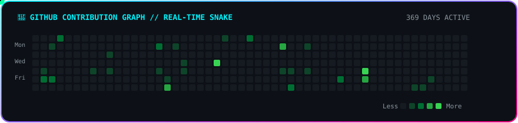

<div align="center">

<!-- Hero Terminal Banner with Automatic Dark/Light Theme Switching & Glowing Neon Aesthetic -->
<picture>
  <source media="(prefers-color-scheme: dark)" srcset="./dark.svg">
  <source media="(prefers-color-scheme: light)" srcset="./light.svg">
  
</picture>

<br />

<!-- Connectivity & Social Badges -->
<p align="center">
  <a href="https://www.linkedin.com/in/puranjay-salaria-b6574027a/" target="_blank">
    
  </a>
  <a href="mailto:puranjay1200@gmail.com">
    
  </a>
  <a href="https://github.com/Puranjaysalaria">
    
  </a>
  <a href="https://komarev.com/ghpvc/?username=puranjaysalaria&label=Profile%20Views&color=38bdf8&style=for-the-badge">
    
  </a>
</p>

</div>

---

### 👨‍💻 About Me

```yaml
Name: Puranjay Salaria
Institution: Thapar Institute of Engineering and Technology (TIET) 🎓
Location: Patiala / Ludhiana, Punjab, India 📍
Discipline: Full-Stack Web Development, Mobile Systems & Applied Machine Learning 🚀
Interests: Scalable Architectures, Modern UI/UX Engineering & Gaming Freak 🎮
```

- 🔭 **Current Focus:** Engineering high-performance full-stack web applications and exploring Deep Learning architectures.
- 🎓 **Education:** Pursuing engineering at Thapar Institute of Engineering and Technology.
- 💬 **Ask me about:** React, Next.js, TypeScript, Flutter, Node.js, Express, Python, and SQL/NoSQL databases.
- ⚡ **Fun Fact:** *I debug with console.log and pure optimism.*

---

### 🐍 Contribution Activity Snake

<div align="center">
  <picture>
    <source media="(prefers-color-scheme: dark)" srcset="./snake-dark.svg">
    <source media="(prefers-color-scheme: light)" srcset="./snake-light.svg">
    
  </picture>
</div>

---

### 📊 Real-Time GitHub Statistics & Streaks

<div align="center">
  <a href="https://github.com/Puranjaysalaria">
    
  </a>
  <a href="https://github.com/Puranjaysalaria">
    
  </a>
</div>

<br />

<div align="center">
  <a href="https://github.com/Puranjaysalaria">
    
  </a>
</div>

---

### 🛠️ Tech Stack & Tooling

<div align="center">

#### **Frontend & Mobile Development**
<a href="https://skillicons.dev">
  
</a>

<br />

#### **Backend, Systems & Databases**
<a href="https://skillicons.dev">
  
</a>

<br />

#### **DevOps, Tooling & Workflow**
<a href="https://skillicons.dev">
  
</a>

</div>

---

### 🚀 Featured Repositories

| Project | Description | Stack | Link |
| :--- | :--- | :--- | :---: |
| 📊 **Zorvyn Finance Dashboard** | Dynamic financial analytics dashboard with interactive charts and real-time metric tracking | `TypeScript` `React` `Tailwind` | [**View Repo** →](https://github.com/Puranjaysalaria/Zorvyn_FinanceDashboard) |
| 💳 **Expense Tracker** | Full-stack budget monitoring system featuring transaction breakdowns and categorization | `Node.js` `Express` `MongoDB` | [**View Repo** →](https://github.com/Puranjaysalaria/expense-track) |
| 🤝 **Joineazy** | Collaborative community platform designed for seamless event sharing and networking | `Full Stack` `JavaScript` `Web` | [**View Repo** →](https://github.com/Puranjaysalaria/Joineazy) |
| 🎮 **Game Findy** | Interactive gaming discovery platform with comprehensive filters and smooth UI animations | `JavaScript` `EJS` `APIs` | [**View Repo** →](https://github.com/Puranjaysalaria/Game_Findy) |

---

<div align="center">
  <sub>Engineered by <a href="https://github.com/Puranjaysalaria">Puranjay Salaria</a> • Built with Neon Terminal Elegance</sub>
</div>
